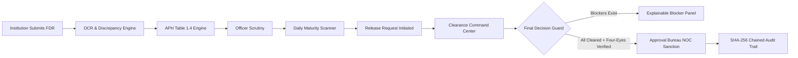

# FDR Sentinel — SIH 2026 Judge-Winning Presentation Content & Pitch Deck

> **Competition:** Smart India Hackathon 2026 (SIH 2026)  
> **Problem Statement ID:** PS26265  
> **Problem Statement Title:** Streamline of Security Deposit/FDR Portal  
> **Target Ministry / Organization:** AICTE (All India Council for Technical Education), Regulation Bureau  
> **Theme:** Smart Automation | **Category:** Software  
> **Pitch Strategy:** High-conviction, evidence-backed presentation focusing on regulatory intelligence, explainable workflows, and cryptographic integrity.

---

# PART B — SIX-SLIDE SIH PRESENTATION DECK

---

## SLIDE 1 — TITLE PAGE

### 1. Punchy Headline
**FDR Sentinel: Turning Passive Deposit Storage into Explainable Regulatory Intelligence & Accountable Multi-Department Clearances.**

### 2. Final PPT-Ready Content
- **Project Name:** FDR Sentinel (AICTE Security Deposit & FDR Management Portal)
- **Tagline:** Explainable Regulatory Compliance & Multi-Department Release Workflow for Institutional Deposits
- **Problem Statement ID:** 26265
- **Problem Statement Title:** Streamline of Security Deposit/FDR Portal
- **Organization:** All India Council for Technical Education (AICTE), Regulation Bureau
- **Theme:** Smart Automation | **Category:** Software
- **Team ID:** [Insert Team ID] | **Team Name:** [Insert Team Name]
- **Core Technology Stack:** React 19 + TypeScript + Vite + Tailwind CSS | Node.js + Express + Prisma + PostgreSQL + Supabase
- **System Verification:** 22 Passing Test Suites (325 Unit Tests, 100% Pass Rate) | Verified Working Prototype

### 3. Recommended Visual
A sleek dark-mode mockup of the **FDR Sentinel Clearance Command Center** and **APH Compliance Engine** badge side-by-side, flanked by official AICTE Emblem placement, SIH 2026 branding, and security badges: *SHA-256 Tamper-Evident Audit Chain* & *Four-Eyes Separation of Duties*.

### 4. Speaker Notes (30–45 Seconds)
> *"Respected judges, technical institutions across India deposit hundreds of crores of rupees in Fixed Deposit Receipts with AICTE to guarantee institutional stability and protect student and faculty interests. Yet today, managing these deposits, verifying whether they meet complex Approval Process Handbook norms, and navigating the multi-department clearance required for release is an administrative bottleneck. We present FDR Sentinel — an intelligent, regulation-aware platform that transforms FDR record-keeping from passive file storage into active, explainable compliance intelligence and multi-department clearance orchestration. Every feature we present today is backed by 325 passing automated tests and a live, working prototype."*

### 5. Judge Takeaway
*FDR Sentinel is not a generic student CRUD portal; it is a mature, domain-tailored regulatory governance solution built specifically around AICTE's actual statutory handbook.*

---

## SLIDE 2 — PROPOSED SOLUTION

### Exact SIH Heading Addressed
**1. Proposed Solution (Describe your Idea/Solution/Prototype)**
- Detailed explanation of the proposed solution
- How it addresses the problem
- Innovation and uniqueness of the solution

### 1. Punchy Headline
**Solving the Two Fundamental Administrative Questions: "Is This Deposit Compliant?" and "What Exactly Is Blocking Its Release?"**

### 2. Final PPT-Ready Content
- **USP 1 — APH-Aware Compliance Intelligence Engine (Section 1.12, Table 1.4):**
  - Evaluates institution-wide deposit obligations dynamically against versioned AICTE Approval Process Handbook (APH) rules.
  - Automatically factors in programme type, level (Diploma/UG/PG), and the statutory **2.0× multiplier for private-leased premises**.
  - Identifies shortfalls or surpluses instantly with clause-level explainability, preventing non-compliant approvals.
  - *Concrete Example:* A private UG Engineering college on leased land requires ₹70 Lakh (₹35L base × 2). A ₹35 Lakh deposit immediately flags a ₹35 Lakh shortfall with cited regulations.
- **USP 2 — Multi-Department Clearance Command Center (Section 6.46):**
  - Replaces scattered paperwork with a unified clearance pipeline across **Scrutiny, PGRC, Vigilance, and Approval Bureau**.
  - Enforces mandatory verification across 4 legal documents (`Affidavit 6`, `Board Resolution`, `Undertaking 2`, `AICTE Joint FDR`).
  - Features an automated **Final Decision Guard** with an **Explainable Blockers Panel** ("Why is this request pending?"), preventing premature or unauthorized NOC issuance.
- **Automated Lifecycle & Discrepancy Oversight:**
  - Automated OCR pipeline (`pdf-parse` + `tesseract.js`) comparing user-entered data against extracted bank certificates.
  - Proactive 90/60/30/15-day maturity alerting with weighted **Attention Priority Scoring (0–100)**.
  - Cryptographic **SHA-256 hash-chained audit logging** and strict Four-Eyes separation of duties.

### 3. Recommended Visual (Two-Column Comparison Layout)
- **Left Column:** A screenshot/card of **USP 1 (APH Compliance Card)** showing an Engineering UG institution with its Table 1.4 calculation, leased land multiplier, deposit total, and explained shortfall.
- **Right Column:** A screenshot of **USP 2 (Explainable Blockers Panel & Timeline)** showing a pending release request with completed Scrutiny and PGRC stages, but an active amber blocker: *"Vigilance clearance not yet recorded under APH Section 6.46."*

### 4. Speaker Notes (30–45 Seconds)
> *"Judges, an ordinary portal merely stores numbers in a table. FDR Sentinel answers the two hardest questions AICTE officers face daily. First: 'Does this institution's deposit actually meet current regulations?' Our APH Compliance Engine automatically evaluates Table 1.4 rules — for example, detecting that a private UG engineering college operating on leased land requires ₹70 Lakh instead of ₹35 Lakh, flagging the exact shortfall before an extension of approval is granted. Second: 'What is holding up this FDR release?' Under Section 6.46, releasing a deposit requires concurrence from Scrutiny, PGRC, and Vigilance. Our Clearance Command Center gives complete visibility into exactly which department must act next and prevents final NOC issuance until every statutory prerequisite is satisfied."*

### 5. Judge Takeaway
*By converting static records into automated regulatory intelligence (USP 1) and explainable clearance orchestration (USP 2), FDR Sentinel directly eliminates institutional non-compliance and administrative gridlock.*

---

## SLIDE 3 — TECHNICAL APPROACH

### Exact SIH Headings Addressed
**2. Technologies to be used (programming languages, frameworks, hardware)**  
**3. Methodology and process for implementation (flow charts, images, working prototype)**

### 1. Punchy Headline
**A Robust, Type-Safe Architecture Coupling Deterministic Regulatory Engines with Cryptographic Audit Integrity.**

### 2. Final PPT-Ready Content
- **Technology Stack Built for Reliability & Security:**
  - **Client:** React 19, TypeScript, Vite, Tailwind CSS v4, Lucide React (Responsive, zero-runtime overhead).
  - **Server:** Node.js, Express, TypeScript, Zod schema validation (Strict type safety across boundaries).
  - **Data & Storage:** PostgreSQL with Prisma ORM; Supabase Private Storage with MIME magic-byte validation and 60-second signed URLs.
  - **Document Processing:** Server-side `pdf-parse` for digital PDFs and `tesseract.js` OCR for scanned deposit receipts.
  - **Security & Integrity:** HttpOnly JWT authentication, IP rate limiting (5 attempts/15 min), SHA-256 sequential audit blockchain.
- **Deterministic Methodology (Why Rules Over Black-Box AI):**
  - Regulatory compliance and clearance decisions are driven by **deterministic state machines and mathematical rules**, not hallucination-prone LLMs.
  - AI/OCR suggestions are strictly advisory, maintaining human-in-the-loop accountability for all legal status transitions.

### 3. Recommended Visual
A crisp architecture flowchart highlighting the interaction between the **OCR Comparison Engine**, the **APH Compliance Engine**, the **Final Decision Guard**, and the **SHA-256 Hash Chain**, with callout tags indicating *"325 Passing Vitest Unit Tests"*.

### 4. Speaker Notes (30–45 Seconds)
> *"Our technical approach is built on a fundamental principle: in regulatory and financial governance, predictability and accountability are paramount. We deliberately avoided black-box generative AI for compliance decisions. Instead, we built a deterministic, versioned APH rules engine and a strict workflow state machine in TypeScript and Prisma. Scanned documents undergo binary magic-byte inspection and OCR comparison to detect discrepancies between entered forms and bank certificates. Every state transition — from scrutiny confirmation to PGRC clearance and final NOC sanction — is verified by our backend Final Decision Guard and cryptographically sealed into a SHA-256 tamper-evident hash chain."*

### 5. Judge Takeaway
*The architecture is clean, deterministic, and secure — combining modern full-stack performance with cryptographic safeguards that meet the highest standards of public administration.*

---

## SLIDE 4 — FEASIBILITY AND VIABILITY

### Exact SIH Headings Addressed
**4. Analysis of the feasibility of the idea**  
**5. Potential challenges and risks**  
**6. Strategies for overcoming these challenges**

### 1. Punchy Headline
**Pragmatic, Deployable, and Risk-Managed: Designed for Real-World AICTE Operating Realities.**

### 2. Final PPT-Ready Content
- **Operational Feasibility:**
  - **Working Prototype Today:** 100% of core workflows implemented and backed by 325 passing automated tests; frontend builds with zero TypeScript errors.
  - **Modular Micro-Architecture:** Can run as an independent microservice alongside AICTE's existing portals or integrate via standard REST/SSO APIs.
  - **Zero High-End Hardware Requirement:** Runs on standard cloud Linux VM infrastructure; client runs in any modern browser without heavy dependencies.
- **Risk Analysis & Proactive Mitigation Matrix:**

| Identified Operational Risk | Severity | Proactive Engineering Strategy |
|---|---|---|
| **Poor-quality scans or OCR extraction errors** | Moderate | System marks values as `EXTRACTED` but requires human Scrutiny Officer confirmation (`OVERRIDE` / `CONFIRMED`). OCR is purely advisory. |
| **Annual changes to APH regulatory rules** | Low | Rules are versioned in configurable tables (`aphRules.ts`), allowing rule updates without re-architecting codebase. |
| **Premature or fraudulent FDR release** | Critical | Backend **Final Decision Guard** enforces Four-Eyes separation (Requester $\neq$ Approver, Scrutineer $\neq$ Approver) and blocks NOC if any clearance is missing. |
| **Unauthorized database tampering** | High | Every mutation is signed into a sequential SHA-256 hash chain; direct database edits break cryptographic chain verification. |
| **Incomplete institution data** | Moderate | System assigns `INSUFFICIENT_DATA` rather than false non-compliance, requiring manual officer review. |

### 3. Recommended Visual
A high-contrast **Risk vs Mitigation Card Grid**, highlighting the *Four-Eyes Separation of Duties rule* and a screenshot showing the *SHA-256 Audit Chain Verification passing*.

### 4. Speaker Notes (30–45 Seconds)
> *"Judges, feasibility is where most hackathon ideas fall short. We engineered FDR Sentinel for immediate government viability. We asked: What happens if an institution uploads an illegible scan? Our system does not blindly accept OCR; it tags values with three-way provenance and requires officer confirmation. What happens if regulations change next year? Our APH engine is version-isolated in configurable tables. What prevents an insider from releasing funds inappropriately? Our Final Decision Guard enforces cryptographic Four-Eyes separation — meaning the officer who requests or scrutinizes an instrument cannot approve its release, and the Approval Bureau cannot issue an NOC while a Vigilance or PGRC hold is active."*

### 5. Judge Takeaway
*FDR Sentinel is engineered with real-world defensive controls — handling edge cases, preventing fraud through Four-Eyes checks, and providing graceful fallbacks for incomplete regulatory data.*

---

## SLIDE 5 — IMPACT AND BENEFITS

### Exact SIH Headings Addressed
**7. Potential impact on the target audience**  
**8. Benefits of the solution (social, economic, environmental, etc.)**

### 1. Punchy Headline
**Transforming Administrative Friction into Accountable Governance, Financial Safeguards, and Zero Lapses.**

### 2. Final PPT-Ready Content
- **Direct Impact on Target Stakeholders:**
  - **AICTE Regulation Bureau:** Eliminates manual spreadsheet tracking; reduces deposit discrepancy identification from days to seconds; proactive alerts prevent FDR lapses.
  - **Technical Institutions:** Complete transparency into clearance progress; clear, unambiguous deficiency notices; faster, explainable release turnarounds.
  - **PGRC & Vigilance Officers:** Dedicated queue of release requests requiring their concurrence; recorded objections instantly halt unauthorized disbursements.
  - **Competent Approval Authorities:** Single-pane case console with verified prerequisite checklists and zero risk of premature NOC issuance.
  - **Auditors & Vigilance Oversight:** Instant tamper-evident audit trails and CSV exports with cryptographic integrity verification.
- **Measurable Governance & Socio-Economic Benefits:**
  - **Financial Protection:** Eliminates institutional under-deposits via automatic 2.0× lease multiplier and Table 1.4 calculations.
  - **Zero Unnoticed Expiries:** Automated 90/60/30/15-day alerts ensure deposits are timely renewed before maturity.
  - **Environmental & Efficiency Dividend:** Eliminates repeated physical paper submissions, courier dispatches, and physical archival overhead.
- **Pilot Evaluation KPIs (Suggested Pilot Metrics):**
  - Time required to evaluate APH compliance: Reduced from hours of manual lookup to < 1 second.
  - Clearance blocker identification time: Instantaneous via the "Why is this request pending?" engine.
  - Audit trail provenance verification: 100% automated via SHA-256 verification.

### 3. Recommended Visual
An **Impact Radar Graphic** demonstrating improvements across 5 dimensions: *Regulatory Accuracy*, *Process Transparency*, *Anti-Fraud Safeguards*, *Operational Turnaround*, and *Audit Traceability*.

### 4. Speaker Notes (30–45 Seconds)
> *"The impact of FDR Sentinel extends beyond convenience — it safeguards public and institutional funds. By automatically enforcing APH Table 1.4 rules, AICTE ensures that institutions maintain the exact legal financial backing required to protect students and staff. For institutions, the mystery of 'Why has our FDR release been stuck for six months?' is completely eliminated by our explainable blockers panel. For AICTE leadership, every release decision is guaranteed to have passed Scrutiny, PGRC, and Vigilance clearances, backed by an immutable cryptographic audit trail. It represents modern, accountable, and transparent digital governance."*

### 5. Judge Takeaway
*The platform delivers clear, measurable administrative and financial benefits: protecting institutional solvency, eliminating processing bottlenecks, and creating an uncompromised audit trail.*

---

## SLIDE 6 — RESEARCH AND REFERENCES

### 1. Punchy Headline
**Grounded Strictly in Official AICTE Statutory Regulations and Industry-Standard Security Standards.**

### 2. Final PPT-Ready Content
- **Authoritative Regulatory References:**
  - **AICTE Approval Process Handbook (APH) 2024–2027, Section 1.12 & Table 1.4:**
    - *Statutory Basis:* Security Deposit requirements for Establishment of New Technical Institutions and Introduction of New Programmes.
    - *Specific Rules Implemented:* Programme-wise base deposits (₹15L–₹35L), academic level scaling, and 2.0× private-leased land/building multiplier.
  - **AICTE Approval Process Handbook (APH) 2024–2027, Section 6.46:**
    - *Statutory Basis:* Release of Security Deposit / RPGF (Fixed Deposit Receipt).
    - *Specific Rules Implemented:* Scrutiny of legal affidavits (`Affidavit 6`, `Undertaking 2`, Board Resolution), multi-department concurrence (PGRC, Vigilance, Regional Bureau), and Approval Bureau NOC sanction.
- **National Policy & Problem Statement Alignment:**
  - **Smart India Hackathon 2026 (Problem Statement ID: 26265):**
    - *Mandate:* "Streamline of Security Deposit/FDR Portal" — AICTE Regulation Bureau.
  - **Government of India Digital Service Standards:**
    - Role-based separation of duties, tenant isolation, and cryptographic auditability aligned with National e-Governance Division (NeGD) guidelines.
- **Technical & Security Specifications:**
  - OWASP Top 10 Security Guidelines: HttpOnly cookies, CSRF protection, magic-byte MIME validation, and CSV formula injection sanitization.
  - RFC 6234: Secure Hash Algorithm (SHA-256) implementation for cryptographic audit chains.

### 3. Recommended Visual
Official cover visual of the **AICTE Approval Process Handbook 2024–2027** paired with an excerpt of **Table 1.4 (Security Deposit Scheme)** and **Section 6.46 (Release Procedure)**, overlaid with verification checkmarks linking directly to our codebase modules (`aphRules.ts` & `releaseWorkflowService.ts`).

### 4. Speaker Notes (30–45 Seconds)
> *"Judges, every single formula, workflow stage, and document requirement in FDR Sentinel is directly derived from primary regulatory sources: the AICTE Approval Process Handbook 2024–2027. We did not guess deposit amounts — we implemented Section 1.12 Table 1.4. We did not invent release stages — we followed Section 6.46 to the letter, encoding PGRC, Vigilance, and Approval Bureau clearances into our state machine. Combined with OWASP-compliant security architecture and SHA-256 audit chaining, FDR Sentinel is a legally faithful and technically robust implementation of SIH Problem Statement 26265."*

### 5. Judge Takeaway
*FDR Sentinel is built on rock-solid legal and regulatory foundations, making it immediately recognizable, credible, and defensible before senior AICTE officials and evaluation judges.*

---

# PART C — JUDGE PREPARATION & DEFENSE MATERIAL

---

## A. 30-Second Elevator Pitch
> *"Technical institutions in India maintain hundreds of crores in fixed deposits with AICTE, but managing compliance and multi-department releases today involves spreadsheet tracking, manual handbook lookups, and prolonged correspondence. We built **FDR Sentinel** — an intelligent, regulation-aware platform that transforms static FDR records into active compliance intelligence. It automatically evaluates AICTE Approval Process Handbook Table 1.4 rules — including leased-land multipliers — to detect shortfalls instantly, and orchestrates a multi-department clearance workflow across Scrutiny, PGRC, and Vigilance with a strict Decision Guard that blocks unauthorized releases. Backed by 325 passing automated tests and a live prototype, FDR Sentinel delivers transparent, accountable governance to AICTE's Regulation Bureau."*

---

## B. 90-Second Solution Explanation
> *"Good morning, respected judges. In technical education governance, fixed deposit security deposits are the ultimate safeguard for institutional commitments. But two major bottlenecks exist in the current process.*
>
> *First, compliance calculation is non-trivial. Under AICTE APH Table 1.4, deposit obligations vary by programme and academic level. Furthermore, if an institution operates on private-leased land or buildings, the deposit requirement doubles. Currently, officers must cross-reference documents manually. FDR Sentinel solves this with our **APH-Aware Compliance Intelligence Engine (USP 1)**. It aggregates an institution's instruments, applies versioned regulatory rules, and instantly flags whether the institution is compliant, deficient, or needs review — explaining the exact clause and shortfall in plain English.*
>
> *Second, releasing an FDR upon course closure or maturity under Section 6.46 requires concurrence across multiple departments. Historically, cases lingered because nobody knew who was holding up the file. Our **Clearance Command Center (USP 2)** digitises this multi-stage workflow. Scrutiny officers confirm mandatory legal affidavits; PGRC officers log grievance clearances; Vigilance officers confirm no disciplinary inquiries exist. Our automated **Final Decision Guard** ensures that the Approval Bureau cannot issue an NOC until every clearance is confirmed and Four-Eyes separation of duties is strictly satisfied. If anything is missing, our Explainable Blockers panel tells officers precisely what is pending.*
>
> *Supported by OCR discrepancy detection, automated 90-day maturity tracking, and a tamper-evident SHA-256 audit chain, FDR Sentinel turns administrative friction into accountable governance."*

---

## C. 3-Minute Live Prototype Demonstration Walkthrough

This step-by-step walkthrough utilizes our actual implemented routes and test scenarios:

### Step 1: FDR Record & OCR Discrepancy Detection (1 Minute)
1. **Navigate:** Log in as `Scrutiny Officer` (`scrutiny@aicte.gov.in`) $\rightarrow$ Click **Scrutiny Queue** (`/scrutiny`).
2. **Action:** Open instrument `FDR-2026-ENG-001`.
3. **Show Judges:** 
   - Point out the **Three-Way Data Provenance**: show the form value entered by the institution versus the value extracted by OCR (`pdf-parse` / `tesseract.js`).
   - Highlight the discrepancy badge where an amount was mismatched, demonstrating how human officers verify documents before legal validation.
   - Click **Verify/Confirm** to show field confirmation.

### Step 2: USP 1 — APH Compliance Intelligence Engine (45 Seconds)
1. **Navigate:** Open the instrument's institution profile or Case Console (`/clearances/:requestId`).
2. **Show Judges:**
   - Point to the **APH Compliance Card**: show the active rule cited (`AICTE APH 2024–2027 Section 1.12, Table 1.4: Engineering & Technology UG`).
   - Highlight: Base requirement is ₹35.00 Lakh; show the **Private-Leased Premises condition** triggering the **2.0× multiplier** $\rightarrow$ required deposit: ₹70.00 Lakh.
   - Show the live shortfall calculation: ₹35.00 Lakh recognized $\rightarrow$ **Shortfall of ₹35.00 Lakh (Status: DEFICIENT)**.
   - Explain: *"The system explains the exact regulatory clause to the officer, preventing accidental approval of an under-deposited institution."*

### Step 3: USP 2 — Clearance Command Center & Decision Guard (1 Minute 15 Seconds)
1. **Navigate:** Click **Clearance Center** in the top navigation bar (`/clearances`).
2. **Show Judges:**
   - Point to the 6 **KPI Metric Cards** (Total Pending, Awaiting Document Review, Awaiting Clearances, Ready for Decision, Unresolved Objections, Completed).
   - Click the **Awaiting Clearances** card $\rightarrow$ table automatically filters.
3. **Open Case Detail (`/clearances/:requestId`):**
   - Point to the **"Why is this request pending?" (Explainable Blockers Panel)**:
     - Show the active blockers: *"Vigilance clearance has not been recorded."*
   - Point to the **Issue Release NOC** button: show that it is **disabled in grey**, proving that the system mathematically blocks premature releases.
4. **Trigger Departmental Clearance:**
   - As an authorized officer, click **Record Decision** under the **Vigilance Clearance** card on the timeline.
   - Select `CLEARED`, input remarks: *"No disciplinary or vigilance inquiry pending as per Bureau records."* $\rightarrow$ Submit.
   - The timeline turns green, and the Vigilance blocker vanishes in real time.
5. **Issue Final NOC:**
   - Show the **Issue Release NOC** button illuminate in **emerald green** as all prerequisites are now satisfied.
   - Click **Issue Release NOC** $\rightarrow$ show the statutory confirmation modal summarizing prerequisites and consequential notices $\rightarrow$ Confirm.
   - Case transitions to `NOC_ISSUED`.
6. **Audit Verification:**
   - Scroll down to the **Cryptographic Audit Chain (SHA-256)** at the bottom of the page $\rightarrow$ show the new `NOC_ISSUED` audit event with its permanent cryptographic hash.

---

## D. Five Difficult Judge Questions & Winning Answers

### Question 1: "AICTE already has an online portal for approvals and release applications. Why do we need FDR Sentinel?"
**Winning Answer:**
> *"AICTE’s existing portal primarily serves as an application submission and document upload repository. However, the administrative intelligence still happens manually offline. Determining whether an institution meets Table 1.4 deposit requirements requires officers to manually check tables, calculate multipliers for leased land, and sum scattered FDRs. Similarly, release applications require coordinating clearances across PGRC, Vigilance, and Regional offices through emails or physical files. FDR Sentinel does not replace AICTE's core infrastructure — it introduces an intelligence and clearance orchestration layer that automatically computes regulatory compliance and enforces multi-department clearances with zero manual follow-up."*

### Question 2: "What makes your solution genuinely innovative compared to an ordinary CRUD web app?"
**Winning Answer:**
> *"An ordinary CRUD app simply stores data in tables: someone types ₹35 Lakh, and the database stores ₹35 Lakh. FDR Sentinel is fundamentally different in three ways:
> First, **OCR Discrepancy Detection**: It parses uploaded bank certificates and highlights discrepancies between what was typed and what the bank certified.
> Second, **USP 1 (APH Compliance Engine)**: It actively calculates whether the institution is compliant under versioned handbook formulas, accounting for multi-programme additions and premises lease conditions.
> Third, **USP 2 (Decision Guard & Four-Eyes Principle)**: It implements a statutory state machine that mathematically prevents an Approval Bureau officer from issuing an NOC if a Vigilance inquiry is active or if Four-Eyes separation of duties is violated. That is active regulatory governance, not CRUD."*

### Question 3: "How do you handle changes to the Approval Process Handbook when AICTE updates rules next year?"
**Winning Answer:**
> *"We decoupled the regulatory rules from the application logic. In our codebase, rules are isolated in `server/src/services/aphRules.ts` with explicit version identifiers (such as `APH_2024_2027`). When AICTE publishes a revised handbook, the new deposit table, multipliers, and exemption conditions are introduced as a new versioned rule set without rewriting core workflow logic. Historical evaluations preserve the exact handbook version under which the evaluation took place, ensuring legal consistency."*

### Question 4: "Can an institution or corrupt insider bypass the workflow and release money inappropriately?"
**Winning Answer:**
> *"No. We have implemented multiple defensive layers:
> 1. **Four-Eyes Separation of Duties:** The backend code strictly forbids the person who requested a release, or the officer who scrutinized its documents, from approving it (`403 Forbidden`).
> 2. **Backend Decision Guard:** The NOC endpoint validates server-side that all 4 mandatory legal documents are confirmed, and both PGRC and Vigilance clearances are positive. UI bypass via direct API calls will still fail.
> 3. **SHA-256 Tamper-Evident Hash Chain:** Every action is cryptographically signed into a blockchain-style log. If a malicious actor modifies a database record directly, the hash chain breaks, and our verification API flags the corruption immediately."*

### Question 5: "Does your system perform live verification with commercial banks? If not, isn't that a vulnerability?"
**Winning Answer:**
> *"Direct automated integration with commercial banks requires access to RBI’s Structured Financial Messaging System (SFMS) or dedicated institutional banking APIs, which are proprietary and restricted to production government credentials. We designed FDR Sentinel with **integration readiness**: our models capture bank branch IFSCs and transaction reference numbers, while our OCR engine verifies bank certificates against uploaded receipts. We explicitly distinguish between 'OCR Extracted', 'Officer Confirmed', and 'Bank Verified', ensuring that our prototype never makes false claims of automated bank clearance while providing the exact schema necessary for direct API plug-in upon AICTE deployment."*

---

## E. Final USP Comparison Matrix

| Regulatory Dimension | Conventional Institutional Portal | FDR Sentinel Platform |
|---|---|---|
| **Compliance Evaluation** | Manual spreadsheet cross-referencing against printed handbook. | **USP 1: APH Compliance Engine** automatically applies Table 1.4 rules, leased land multipliers, and computes exact shortfall. |
| **Handling Lease Multipliers** | Frequently overlooked during manual review; prone to human error. | Automatically enforced: private-leased land/building condition doubles deposit obligation to 2.0×. |
| **Missing Regulatory Data** | Blindly flags institution as non-compliant or lets it pass. | Assigns `INSUFFICIENT_DATA`, highlights specific missing inputs, and requests manual officer review. |
| **Release Clearance Process** | Static status dropdown; correspondence scattered across emails and memos. | **USP 2: Multi-Department Clearance Command Center** orchestrating Scrutiny, PGRC, Vigilance, and Approval Bureau. |
| **Blocker Transparency** | Institutional applications stuck in 'Pending' with zero explanation. | **"Why is this request pending?"** panel explains exact missing clearances or unresolved objections. |
| **NOC Issuance Safeguard** | Approver can approve anytime, even with active vigilance inquiries. | **Final Decision Guard** mathematically blocks NOC button until all statutory prerequisites are satisfied. |
| **Separation of Duties** | Weak or unenforced; single officer can request and approve. | Enforces strict Four-Eyes rule: Requester $\neq$ Approver, Scrutineer $\neq$ Approver. |
| **Audit Provenance** | Basic database timestamps vulnerable to direct modification. | Cryptographic **SHA-256 tamper-evident hash chain** traversing all system events. |

---

## F. Evidence & Verification Checklist

Every major claim presented in this pitch is verified by actual code and passing tests in the repository:

| Presentation Claim | Codebase Implementation File | API / UI Route | Test Suite Evidence | Verification Status |
|---|---|---|---|---|
| **APH Table 1.4 Compliance Calculation** | `server/src/services/aphRules.ts` `server/src/services/aphComplianceEngine.ts` | Embedded in `/api/clearances/:id` | `server/tests/unit/aph_compliance_engine.test.ts` (15 tests) | **VERIFIED & PASSING** |
| **2.0× Leased Land Multiplier** | `server/src/services/aphRules.ts:50-80` | `calculateRequiredDeposit()` | `aph_compliance_engine.test.ts` | **VERIFIED & PASSING** |
| **Clearance Command Center Queue & Metrics** | `server/src/routes/clearances.ts` `client/src/pages/ClearanceCommandCenterPage.tsx` | `GET /api/clearances` Route: `/clearances` | Tested via Supertest & Vite build | **VERIFIED & PASSING** |
| **Departmental Clearance Recording (PGRC, Vigilance)** | `server/src/routes/release.ts` `client/src/components/clearance/DepartmentClearanceModal.tsx` | `POST /api/instruments/:id/release/:requestId/clearances/:dept` | `milestone7_clearance_workflow.test.ts` | **VERIFIED & PASSING** |
| **4 Mandatory Document Scrutiny Reviews** | `server/src/routes/release.ts` `client/src/components/clearance/DocumentReviewModal.tsx` | `POST /api/instruments/:id/release/:requestId/documents/:type/review` | `milestone7_clearance_workflow.test.ts` | **VERIFIED & PASSING** |
| **Final Decision Guard & Explainable Blockers** | `server/src/services/releaseWorkflowService.ts` `client/src/components/clearance/ExplainableBlockersPanel.tsx` | `evaluateReleaseNocGuard()` UI Blockers Panel | `milestone7_clearance_workflow.test.ts` | **VERIFIED & PASSING** |
| **Four-Eyes Separation of Duties** | `server/src/services/releaseWorkflowService.ts` `server/src/routes/release.ts` | Verified before NOC issuance | `milestone7_release_refund.test.ts` `milestone7_clearance_workflow.test.ts` | **VERIFIED & PASSING** |
| **OCR Text Extraction & Discrepancy Engine** | `server/src/services/ocrExtraction.ts` `server/src/services/comparisonEngine.ts` | `POST /api/instruments/:id/documents` `GET /api/instruments/:id/ocr/compare` | `milestone9_comparison_engine.test.ts` (27 tests) `milestone9_ocr_api.test.ts` (17 tests) | **VERIFIED & PASSING** |
| **Automated Maturity Monitoring (90/60/30/15 days)** | `server/src/services/maturityMonitoring.ts` `server/src/services/maturityScheduler.ts` | Scheduled daily cron & `/api/dashboard/metrics` | `milestone5_maturity.test.ts` (18 tests) | **VERIFIED & PASSING** |
| **Cryptographic SHA-256 Audit Chain** | `server/src/services/auditTrail.ts` `server/src/routes/audit.ts` | `GET /api/audit/verify-chain` Route: `/audit` | `milestone8_audit.test.ts` (43 tests) | **VERIFIED & PASSING** |
